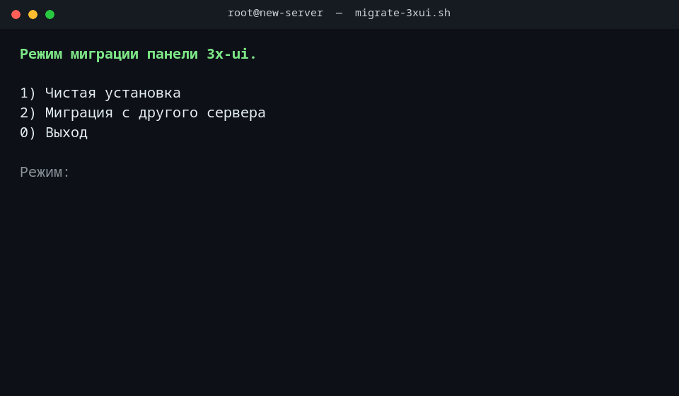
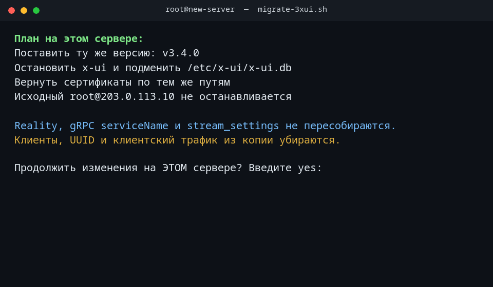

# 3x-ui migrate

Интерактивный перенос панели [3x-ui](https://github.com/MHSanaei/3x-ui) на новый сервер. Клиенты и их UUID пропадают, параметры инбаундов и Reality остаются.

Interactive move of an [3x-ui](https://github.com/MHSanaei/3x-ui) panel onto a new server. Clients and their UUIDs are dropped. Inbound parameters and Reality stay as they were.

Скрипт запускается **от root уже на новом сервере**. Исходный сервер только читается и продолжает работать, пока оператор сам не проверит новый.

Run it **as root on the new server**. The source server is only read, and it keeps running until you have checked the new one yourself.





Демо собрано локально и не содержит ключей, паролей и настоящей базы. Цифры на гифках — пример.

The clips were rendered locally. They contain no keys, passwords, or a real database. The numbers are an example.

## Русский

### Что получается

На чистом сервере оказывается та же панель: те же инбаунды (vless+reality, grpc, tcp, websocket, xhttp и любые другие транспорты), тот же порт панели, те же пути сертификатов. Клиентов нет: ни строк в таблицах, ни UUID в `settings`, ни клиентского трафика. Старые ссылки после этого не подходят.

Не меняются и не генерируются заново: `stream_settings` целиком, ключи Reality (`privateKey`, `shortIds`, `serverNames`, `dest`), SNI, serviceName gRPC, пути, порт инбаунда, `protocol`, `listen`, `remark`, `enable`, лимиты и срок самого инбаунда.

Это официальная схема переноса из документации 3x-ui: копия SQLite и сертификатов, установка той же версии, остановка панели, подмена базы, сертификаты по тем же абсолютным путям. Через большой скачок версии схему мигрирует сама панель, но этот скрипт версию во время переноса не повышает.

### Требования

- Linux, root, интерактивный терминал
- Python 3 с модулем `sqlite3`
- `curl`
- SSH-ключ или ssh-agent. Пароль в скрипт не записывается

На источнике для согласованной копии нужен `sqlite3` или бинарник `x-ui` с `migrate-db --dump`. Живой `cp` работающей базы не используется.

### Запуск

```bash
sudo bash migrate-3xui.sh
sudo bash migrate-3xui.sh --dry-run
```

1. **Чистая установка.** Скачивается [официальный install.sh](https://raw.githubusercontent.com/mhsanaei/3x-ui/master/install.sh) и запускается с `XUI_NONINTERACTIVE=1`. Пустой или неузнаваемый файл не запускается. Журнал установщика на экран не выводится. Учётные данные лежат в `/etc/x-ui/install-result.env`. `dev-latest` не ставится.

2. **Миграция с другого сервера.** Скрипт спрашивает хост, пользователя, порт и ключ. Перед изменением нового сервера показывает план и ждёт слово `yes`. Ставится та же версия `vX.Y.Z`, панель останавливается, база подменяется очищенной копией, сертификаты возвращаются по тем же путям, панель запускается.

`--dry-run` снимает копию, считает инбаунды, клиентов и сертификаты и ничего не ставит и не подменяет.

После подмены вход в панель — пользователь из таблицы `users` и прежний пароль. Случайные данные из `install-result.env` больше не подходят. Хеш пароля скрипт не печатает.

### Что остаётся и что уходит

| Остаётся | Уходит |
| --- | --- |
| Инбаунды, транспорты, Reality, TLS-пути | Строки `clients` и связанные таблицы |
| Пользователи панели и хеш пароля | UUID и пароли клиентов внутри `settings` |
| Настройки панели, шаблон Xray, порт, подписка | `inbounds.up` / `down` и клиентский трафик |
| `api_tokens` (там только SHA-256) | Старые клиентские ссылки |
| `history_of_seeders` и схема таблиц | |

Отдельно, и только после своего `yes`:

- `hosts.address` и `inbounds.share_addr`, если там адрес старого сервера
- продолжение, когда у инбаунда ненулевой `node_id` или заполнен `origin_node_guid` (локальный Xray может его не слушать)

Токены Telegram и Discord не выключаются. После запуска оба сервера могут слать одни и те же уведомления. Старый plaintext API-токен, если он сохранён у оператора, останется рабочим: в базе только SHA-256, и скрипт его не показывает.

Команды `ufw` и `nftables` печатаются по фактическим портам. `ufw enable` и `nft flush` не выполняются: default-deny легко обрывает текущую SSH-сессию. `ufw allow` пишется только если оператор подтвердит это отдельно и `ufw` уже установлен.

Если на новом сервере уже есть база со своими инбаундами, она не затирается без второго `yes`.

### Чего скрипт не делает

- Не останавливает и не удаляет 3x-ui на исходном сервере.
- Не импортирует базу старой панели x-ui. Документация это не поддерживает.
- Не переносит PostgreSQL. Для него путь другой: `x-ui migrate-db --dsn` и переменные в `/etc/default/x-ui`.
- Не создаёт инбаунды через REST API и не генерирует новые ключи x25519.
- Не печатает privateKey, пароль панели, DSN и токены ботов.

### Проверка

```bash
python3 -m unittest discover -s tests -v
bash tests/test_migrate_helpers.sh
```

В конце миграции скрипт сам сверяет числа: сервис `x-ui` active, число инбаундов и reality совпало, `clients` пуст, у reality на месте `privateKey`, `serverNames`, `shortIds` и `dest`, панель слушает `webPort` из settings.

### Состав

| Файл | Зачем |
| --- | --- |
| `migrate-3xui.sh` | Меню, SSH, установка, подмена базы |
| `strip_clients.py` | Правка JSON в копии SQLite |
| `tests/` | Проверки очистки и разбора версии |

## English

### Result

A clean server ends up with the same panel: the same inbounds (vless+reality, grpc, tcp, websocket, xhttp, and any other transport), the same panel port, and the same certificate paths. There are no clients: no table rows, no UUIDs in `settings`, and no client traffic. Old client links stop working.

These are left untouched and are not generated again: the whole `stream_settings` object, Reality (`privateKey`, `shortIds`, `serverNames`, `dest`), SNI, the gRPC serviceName, paths, the inbound port, `protocol`, `listen`, `remark`, `enable`, and the inbound's own limits and expiry.

That matches the upstream move: copy SQLite and the certificates, install the same version, stop the panel, put the database back, restore certificates at the same absolute paths. The panel can migrate its own schema across a large version jump, but this script does not upgrade during the move.

### Requirements

- Linux, root, an interactive terminal
- Python 3 with the `sqlite3` module
- `curl`
- An SSH key or ssh-agent. The script never stores an SSH password

The source needs `sqlite3` or an `x-ui` binary that supports `migrate-db --dump`, so the copy is consistent. A live `cp` of the running database is not used.

### Run

```bash
sudo bash migrate-3xui.sh
sudo bash migrate-3xui.sh --dry-run
```

1. **Clean install.** Downloads the [official install.sh](https://raw.githubusercontent.com/mhsanaei/3x-ui/master/install.sh) and runs it with `XUI_NONINTERACTIVE=1`. An empty or unrecognised file is not executed. The installer log is kept off the screen. Credentials are written to `/etc/x-ui/install-result.env`. `dev-latest` is not installed.

2. **Move from another server.** The script asks for the host, user, port, and key. Before it changes the new server it prints a plan and waits for the word `yes`. It installs the same `vX.Y.Z`, stops the panel, swaps in the cleaned database, puts certificates back on the same paths, and starts the panel.

`--dry-run` copies the database, counts inbounds, clients, and certificates, and does not install or replace anything.

After the swap, sign in as the user from the `users` table, with the old password. The random credentials in `install-result.env` no longer work. The password hash is never printed.

### What stays and what goes

| Stays | Goes |
| --- | --- |
| Inbounds, transports, Reality, TLS paths | `clients` rows and the related tables |
| Panel users and the password hash | Client UUIDs and passwords inside `settings` |
| Panel settings, Xray template, port, subscription | `inbounds.up` / `down` and client traffic |
| `api_tokens` (SHA-256 only) | Old client share links |
| `history_of_seeders` and the table schema | |

Only after their own `yes`:

- rewriting `hosts.address` and `inbounds.share_addr` when they still point at the old server
- continuing when an inbound has a non-zero `node_id` or a set `origin_node_guid` (local Xray may not listen on it)

Telegram and Discord tokens are left enabled. After startup both servers can send the same notifications. A plaintext API token you already saved keeps working: the database stores only SHA-256, and the script never shows it.

`ufw` and `nftables` commands are printed from the real ports. `ufw enable` and `nft flush` are not run, because a default-deny policy can drop the current SSH session. `ufw allow` is applied only after a separate confirmation, and only when `ufw` is already installed.

If the new server already has a database with its own inbounds, it is not overwritten without a second `yes`.

### Out of scope

- The script does not stop or uninstall 3x-ui on the source.
- It does not import a legacy x-ui database. Upstream does not support that.
- It does not move PostgreSQL. That path is `x-ui migrate-db --dsn` plus the variables in `/etc/default/x-ui`.
- It does not create inbounds through the REST API and does not generate new x25519 keys.
- It does not print a Reality privateKey, the panel password, a DSN, or bot tokens.

### Tests

```bash
python3 -m unittest discover -s tests -v
bash tests/test_migrate_helpers.sh
```

At the end of a real migration the script checks the numbers itself: `x-ui` is active, inbound and Reality counts match, `clients` is empty, each Reality inbound still has `privateKey`, `serverNames`, `shortIds`, and `dest`, and the panel listens on the `webPort` from settings.

### Files

| File | Role |
| --- | --- |
| `migrate-3xui.sh` | Menu, SSH, install, database swap |
| `strip_clients.py` | JSON edits on the SQLite copy |
| `tests/` | Strip and version-parsing checks |
